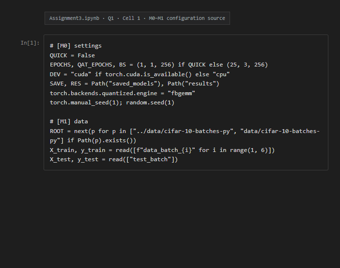
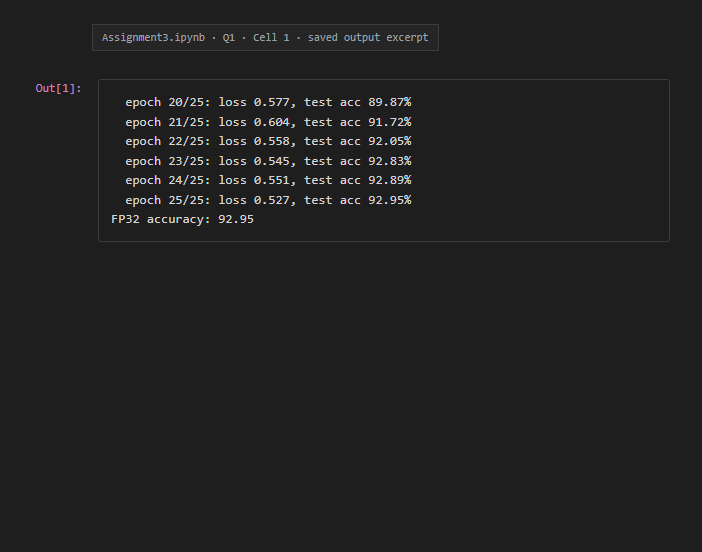
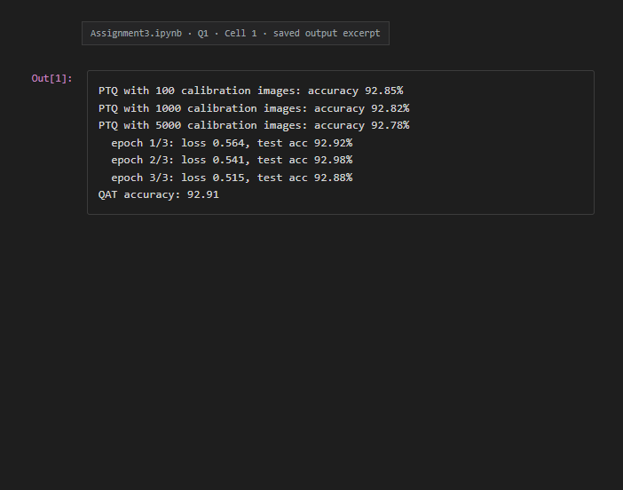
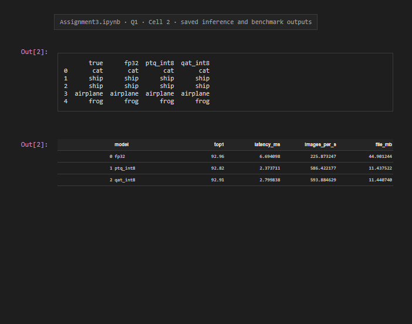
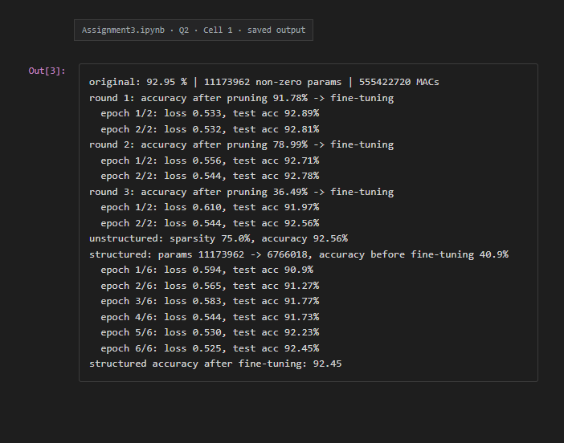
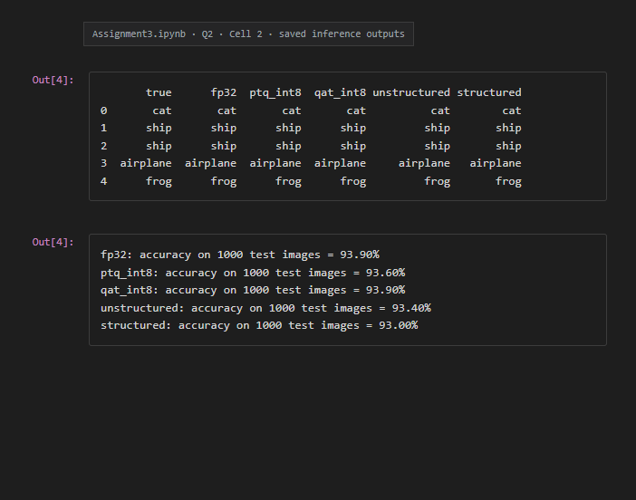
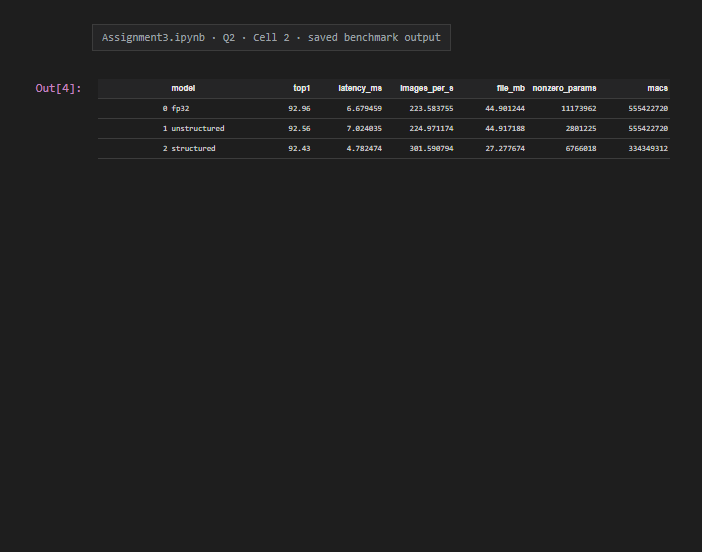
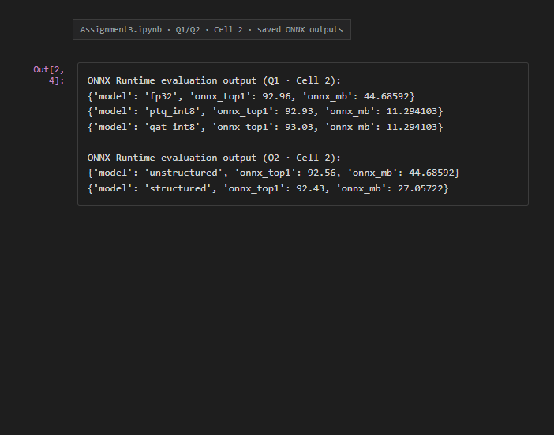
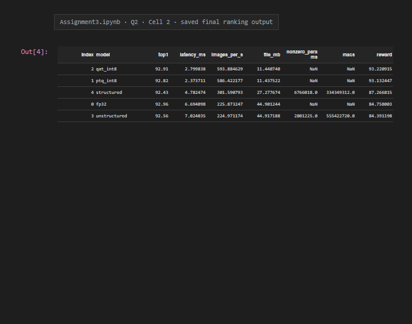

# Compressing ResNet-18 for Edge Inference: Quantization and Pruning on CIFAR-10

**Edge AI — Assignment 3 Technical Report**
**Student:** Muhammad Soban  ·  **Roll No.:** i230056  ·  **Section:** AI-7A  ·  **Date:** 13 November 2026

> Evidence images are renderings of content saved in `Assignment3.ipynb`; they are not screenshots of a fresh run. Figures 2–9 reproduce saved cell outputs. Figure 1 shows the notebook configuration source because M0–M1 did not save a separate setup output.

---

## 1. Overview

This report describes a PyTorch pipeline that takes one ResNet-18 trained on CIFAR-10 and produces four compressed variants for CPU deployment:

| Variant | Technique | Question |
|---|---|---|
| `fp32` | Baseline, 32-bit floating point | Q1.1 / Q2.1 |
| `ptq_int8` | Post-Training Static Quantization to INT8 | Q1.2 |
| `qat_int8` | Quantization-Aware Training, then INT8 conversion | Q1.3 |
| `unstructured` | Iterative layer-wise L1 magnitude pruning (75 % of weights) | Q2.2 |
| `structured` | Channel pruning by BatchNorm scaling factors, with network surgery | Q2.3 |

Every model is exported to TorchScript and ONNX. All five are evaluated by the same benchmark on the full 10 000-image test set.

**Main results.**
- **INT8 quantization:** both INT8 models are 3.9× smaller and about 2.4–2.8× faster than FP32 on the CPU, and lose at most 0.14 percentage points of accuracy.
- **Structured pruning:** cuts compute by 40 % and gives a 1.40× speed-up at −0.53 pp.
- **Unstructured pruning:** removes 75 % of the weights with only −0.40 pp, but gives no speed or storage benefit with dense kernels.

## 2. Setup

| | |
|---|---|
| Dataset | CIFAR-10, read directly from the original pickle batches (50 000 train / 10 000 test) |
| Input normalisation | mean (0.4914, 0.4822, 0.4465), std (0.2470, 0.2435, 0.2616) |
| Training hardware | NVIDIA GeForce RTX 3060 (12 GB) |
| Benchmark hardware | Intel Core i5-12400F (6 cores / 12 threads), **4 threads** for every CPU measurement |
| Software | Python 3.11, PyTorch 2.5.1 + CUDA 12.1, torchvision 0.20.1, ONNX Runtime 1.24 |
| INT8 backend | `fbgemm` (x86) |

The hardware above is the experiment configuration recorded in the existing report and notebook results.

**Data pipeline.** The whole training set is kept on the GPU as one tensor. Each mini-batch is augmented on the GPU itself:
- a random horizontal flip for each image;
- a random shift of up to ±4 pixels in each direction, applied to the whole batch with `torch.roll`.

This avoids a CPU `DataLoader` bottleneck, so the GPU is never waiting for data.

**Model.** The quantization-ready ResNet-18 from `torchvision.models.quantization` is used. It already includes `QuantStub`/`DeQuantStub`, quantizable residual additions and `fuse_model()`. For 32×32 inputs the 7×7 stride-2 stem is replaced by a 3×3 stride-1 convolution and the max-pool is removed. The model has **11 173 962 parameters** and **555.4 M MACs** per image. MACs are counted analytically from each convolution and linear layer's shape.

---

## 3. Question 1 — Quantization

### 3.1 FP32 baseline (M4)

The baseline was trained for 25 epochs with these settings:
- SGD with Nesterov momentum 0.9 and weight decay 5·10⁻⁴;
- batch size 256;
- OneCycle learning-rate schedule with a peak of 0.1;
- cross-entropy loss with label smoothing 0.1.

OneCycle reaches a good accuracy in few epochs. Label smoothing slightly regularises the over-confident logits. Accuracy rose quickly over the last epochs as the learning rate annealed, from 89.87 % at epoch 20 to **92.95 %** at epoch 25.

| | FP32 baseline |
|---|---|
| Test accuracy (GPU) | 92.95 % |
| Test accuracy (CPU, TorchScript) | 92.96 % |
| Checkpoint `fp32_weights.pth` | 44.8 MB |

The 0.01 pp difference between GPU and CPU comes from different floating-point kernels. It is one image out of 10 000.

### 3.2 Post-Training Static Quantization (M5)

The PTQ function performs the five required steps:

1. **Fusion.** `fuse_model()` folds every Conv-BN(-ReLU) group, including the down-sampling shortcuts, into one convolution.
2. **Backend.** `get_default_qconfig("fbgemm")`: activations are per-tensor `quint8` with a histogram observer; weights are per-channel symmetric `qint8`. `prepare()` inserts the observers.
3. **Calibration.** A random subset of training images is forwarded through the model in batches of 100 to record activation ranges.
4. **Conversion.** `convert()` produces INT8 modules (`QuantizedConvReLU2d`, `QuantizedLinear`, quantized `add_relu`).
5. **Deployment.** The INT8 weights are saved (`ptq_int8_weights.pth`). The model is traced to TorchScript (`ptq_int8.ts`) for code-free loading.

**Calibration-size sweep.** Before fixing the number of calibration images, PTQ was run with three sizes:

| Calibration images | 100 | 1 000 | 5 000 |
|---|---|---|---|
| PTQ-INT8 accuracy | 92.85 % | 92.82 % | 92.78 % |

The three results are within 0.07 pp, about seven test images. For this network, **calibration is not sensitive to the amount of data**: even 100 images give a stable estimate of the activation ranges. More data does not help, because the histogram observer already captures the range shape well. 1 000 images were used for the final model as a safe middle value. The final PTQ model reaches **92.82 %** (−0.14 pp vs FP32).

### 3.3 Quantization-Aware Training (M6)

1. A copy of the trained FP32 model is fused in QAT mode (`fuse_model(is_qat=True)`), which keeps BatchNorm trainable inside `ConvBnReLU2d`.
2. `prepare_qat()` with `get_default_qat_qconfig("fbgemm")` inserts **fake-quantization** modules on weights and activations. These round values to the INT8 grid in the forward pass and use the straight-through estimator in the backward pass.
3. The model is fine-tuned for 3 epochs with SGD and a OneCycle schedule (peak 10⁻³). BatchNorm statistics are frozen from epoch 2 and the quantization observers (scales and zero-points) from epoch 3, so the last epoch trains against fixed quantization parameters.
4. The model is converted with `convert()` and saved (`qat_int8_weights.pth`, `qat_int8.ts`).

| QAT epoch | 1 | 2 | 3 | After INT8 conversion |
|---|---|---|---|---|
| Test accuracy | 92.92 % | 92.98 % | 92.88 % | **92.91 %** |

### 3.4 Inference pipeline and benchmark (M7–M8)

All three models are traced to TorchScript (`.ts`). `load(name)` and `classify(name, images)` give one interface for every model, and none of them needs the Python model definition. On the first five test images all three models predict the correct class.

The benchmark (`bench()`) runs each TorchScript model on the CPU with 4 threads and measures:
- **top-1 accuracy** on all 10 000 test images;
- **latency:** mean of 100 single-image calls, timed with `torch.utils.benchmark.Timer`;
- **throughput:** images per second over the whole test set in batches of 1 000;
- **file size** of the TorchScript file.

Per-image predictions are saved to `results/q1_predictions.csv` and the metrics to `results/q1_benchmark.csv`.

| Model | Top-1 (%) | Δ vs FP32 | Latency (ms) | Speed-up | Throughput (img/s) | Size (MB) | Compression |
|---|---|---|---|---|---|---|---|
| FP32 | 92.96 | — | 6.69 | 1.00× | 226 | 44.90 | 1.00× |
| PTQ-INT8 | 92.82 | −0.14 | 2.37 | 2.82× | 586 | 11.44 | 3.93× |
| QAT-INT8 | 92.91 | −0.05 | 2.80 | 2.39× | 594 | 11.44 | 3.92× |

---

## 4. Question 2 — Pruning

The pruning experiments start from the same FP32 baseline: 92.95 % accuracy, 11 173 962 non-zero parameters and 555.4 M MACs.

### 4.1 Unstructured pruning (M11)

**Method.** Each `Conv2d` and `Linear` layer is pruned **independently** with `prune.l1_unstructured`. In every layer, the weights with the smallest absolute values are masked to zero. Pruning is iterative: 3 rounds, each removing 37 % of the weights that are still unpruned. That gives a cumulative sparsity of 1 − 0.63ʳ, i.e. 37 % → 60.3 % → **75.0 %**.

After every round the network is fine-tuned for 2 epochs (OneCycle, peak lr 0.01) with the masks active, so pruned weights stay at zero. At the end, `prune.remove()` multiplies each mask into its weight and deletes the `weight_orig`/`weight_mask` re-parametrisation. This makes the zeros permanent in a plain state dict.

| Round | Sparsity | Accuracy right after pruning | Accuracy after fine-tuning |
|---|---|---|---|
| 1 | 37.0 % | 91.78 % | 92.81 % |
| 2 | 60.3 % | 78.99 % | 92.78 % |
| 3 | 75.0 % | 36.49 % | **92.56 %** |

Each pruning step hurts more than the one before, because each removes larger weights: round 3 alone drops accuracy to 36 %. Two epochs of fine-tuning still recover almost all of it every time. This is why iterative pruning with fine-tuning works better than one large cut. The final model keeps **2 801 225 non-zero parameters**, 25.1 % of the original, at −0.40 pp.

### 4.2 Structured channel pruning (M12)

**Which channels.** In a ResNet BasicBlock, the output channels of `conv2` are added to the skip connection. Those channels are therefore shared by every block in a stage, and removing one would require matching changes in many layers. The **inner** channels (`conv1` output → `bn1` → `conv2` input) belong to a single block, so they can be removed while all tensor shapes remain valid.

**Importance.** Each inner channel is scored by the magnitude of its BatchNorm scaling factor |γ| in `bn1`. A channel with a small γ is scaled down before the ReLU and contributes little. The 60 % of channels with the largest |γ| are kept in every block, and 40 % are removed.

**Network surgery.** For every block, three new, smaller layers replace the old ones:

| Layer | Before | After | Copied from the original |
|---|---|---|---|
| `conv1` | C × C_in × 3 × 3 | 0.6C × C_in × 3 × 3 | kept output filters |
| `bn1` | C | 0.6C | γ, β, running mean and variance of kept channels |
| `conv2` | C_out × C × 3 × 3 | C_out × 0.6C × 3 × 3 | kept **input** channels |

The result is a smaller dense network that does not rely on masks or zero-valued channels. The full module is saved with `torch.save` (`structured_full_model.pth`), so the new layer sizes are preserved.

| | Original | Structured |
|---|---|---|
| Parameters | 11 173 962 | 6 766 018 (−39.4 %) |
| MACs | 555.4 M | 334.3 M (−39.8 %) |
| Accuracy right after surgery | — | 40.9 % |
| Accuracy after 6 epochs of fine-tuning | 92.95 % | **92.45 %** |

Accuracy right after surgery is low (40.9 %). |γ| alone is an imperfect importance score: the baseline was not trained with a sparsity penalty on γ, so many channels have similar scales. A channel with a small γ but a large β still sends a constant, non-zero signal into `conv2`, and removing it shifts that layer's input. Fine-tuning corrects this quickly: 90.9 % after one epoch and 92.45 % after six.

### 4.3 Fine-tuning pipeline (Q2.4)

Both approaches reuse the same `fit()` routine that trained the baseline (SGD, Nesterov, OneCycle, label smoothing, GPU augmentation), with a lower peak learning rate of 0.01:

| | Unstructured | Structured |
|---|---|---|
| Schedule | 2 epochs after each of 3 rounds | 6 epochs after surgery |
| Total epochs | 6 | 6 |
| Accuracy recovered | 36.49 % → 92.56 % (last round) | 40.9 % → 92.45 % |

### 4.4 Export and inference (M13–M14)

| Model | State / full model | TorchScript | ONNX |
|---|---|---|---|
| Unstructured | `unstructured_weights.pth` | `unstructured.ts` | `unstructured.onnx` |
| Structured | `structured_full_model.pth` | `structured.ts` | `structured.onnx` |

All five models then pass through the same `classify()` pipeline, and all predict the first five test images correctly. A standalone script, `run_inference.py`, loads any of the ONNX models with ONNX Runtime on the CPU and reports accuracy on the first N test images. It needs no PyTorch code. On the first 1 000 test images it gave:

| fp32 | ptq_int8 | qat_int8 | unstructured | structured |
|---|---|---|---|---|
| 93.9 % | 93.6 % | 93.9 % | 93.4 % | 93.0 % |

These are higher than the full-test-set figures only because the first 1 000 images happen to be slightly easier.

### 4.5 Benchmark (M15)

The benchmark uses the same protocol as Q1, adding non-zero parameters and MACs (`results/q2_benchmark.csv`, `results/q2_predictions.csv`):

| Model | Top-1 (%) | Δ | Latency (ms) | Speed-up | Throughput (img/s) | Size (MB) | Non-zero params | MACs |
|---|---|---|---|---|---|---|---|---|
| Original | 92.96 | — | 6.68 | 1.00× | 224 | 44.90 | 11 173 962 | 555.4 M |
| Unstructured | 92.56 | −0.40 | 7.02 | 0.95× | 225 | 44.92 | 2 801 225 | 555.4 M |
| Structured | 92.43 | −0.53 | 4.78 | 1.40× | 302 | 27.28 | 6 766 018 | 334.3 M |

---

## 5. ONNX Deployment (M9, M13)

All five models were exported with `torch.onnx.export` (opset 17, dynamic batch axis), checked, and run with ONNX Runtime's CPU execution provider on the full test set (`results/onnx_results.csv`):
- **FP32 and pruned models** export to standard `Conv`/`Gemm`/`Relu`/`Add` graphs.
- **INT8 models** export in QDQ format: INT8 weights with `QuantizeLinear`/`DequantizeLinear` nodes, which ONNX Runtime fuses into integer kernels.

| Model | TorchScript top-1 (%) | ONNX Runtime top-1 (%) | ONNX size (MB) |
|---|---|---|---|
| fp32 | 92.96 | 92.96 | 44.69 |
| ptq_int8 | 92.82 | 92.93 | 11.29 |
| qat_int8 | 92.91 | 93.03 | 11.29 |
| unstructured | 92.56 | 92.56 | 44.69 |
| structured | 92.43 | 92.43 | 27.06 |

- **Float models:** ONNX Runtime reproduces their accuracy exactly.
- **INT8 models:** accuracy differs by about 0.1 pp, roughly ten images, because ONNX Runtime and PyTorch's `fbgemm` use slightly different integer rounding inside the fused kernels. Neither runtime is consistently better.

---

## 6. Choosing a Model for Deployment

To compare all five models with one number, accuracy is combined with model size using a MnasNet-style weighted reward (Tan et al., 2019):

  reward = accuracy × (size / budget)^w,  w = −0.07, budget = 12 MB

Here the edge device is assumed to be **memory-constrained**, so file size is the cost. Models larger than the budget are penalised smoothly rather than rejected.

| Rank | Model | Top-1 (%) | Size (MB) | Latency (ms) | Reward |
|---|---|---|---|---|---|
| 1 | **qat_int8** | 92.91 | 11.44 | 2.80 | **93.22** |
| 2 | ptq_int8 | 92.82 | 11.44 | 2.37 | 93.13 |
| 3 | structured | 92.43 | 27.28 | 4.78 | 87.27 |
| 4 | fp32 | 92.96 | 44.90 | 6.69 | 84.76 |
| 5 | unstructured | 92.56 | 44.92 | 7.02 | 84.39 |

---

## 7. Discussion

**INT8 quantization gives the best trade-off.** Storing weights in 8 bits instead of 32 reduces the files by 3.9×. The small remainder above 4× comes from scales, zero-points and graph metadata. INT8 kernels also move a quarter of the data and use integer SIMD instructions, giving a 2.4–2.8× latency gain and 2.6× throughput in PyTorch. Both INT8 models lose at most 0.14 pp.

**PTQ was already nearly lossless, so QAT had little to recover.** In theory QAT should beat PTQ, because the weights adapt to rounding noise. Here PTQ lost only 0.14 pp, and QAT closed that to 0.05 pp. The 0.09 pp gap is nine test images, which is within run-to-run noise, so the honest conclusion is that **both methods are effectively equivalent for this model**.
- **Why PTQ worked so well:** ResNet-18 with per-channel weight quantization and BatchNorm folding has well-behaved activation ranges, as the calibration sweep also showed.
- **When QAT matters more:** for compact networks with depthwise convolutions (e.g. MobileNet) or for lower bit-widths, where PTQ errors are much larger.
- **Cost:** PTQ needs a few seconds of calibration; QAT needs 3 extra training epochs.

**The PTQ/QAT latency difference is noise.** The batch-1 latency of QAT (2.80 ms) is slightly higher than PTQ (2.37 ms), but the two are not different models. Both TorchScript graphs contain the same 31 quantized operators, their throughput is the same (586 vs 594 img/s), and re-timing both gave overlapping ranges (2.3–2.7 ms). A single batch-1 timing on a desktop CPU varies by a few tenths of a millisecond between runs.

**Unstructured pruning reduces parameters, not cost.** Removing 75 % of the weights cost only 0.40 pp, which shows how over-parameterised ResNet-18 is for CIFAR-10. However:
- **No speed-up:** latency (7.02 vs 6.68 ms), dense file size and MACs are unchanged, because standard dense kernels still multiply every zero.
- **When the benefit appears:** only with sparse storage, such as a zip-compressed checkpoint, or with sparse-aware hardware and libraries.

**Structured pruning gives real but smaller gains.** Removing 40 % of each block's inner channels made the network itself smaller:
- **Cost reductions:** 39.4 % fewer parameters, 39.8 % fewer MACs, 1.65× smaller files and 1.40× lower latency, all with ordinary dense kernels.
- **Why the speed-up is below the MAC reduction:** fixed per-layer overheads and the unpruned stem, residual and classifier layers still take time.
- **Importance criterion:** |γ| alone was a weak predictor of channel importance before fine-tuning, as Section 4.2 showed. Training the baseline with an L1 penalty on γ (full Network Slimming) would likely make the drop before fine-tuning much smaller.

**Combining techniques.** Pruning and quantization act on different things: the number of channels versus the precision of each number. Applying INT8 quantization to the structured-pruned model would be expected to multiply their gains (≈ 1.65 × 3.9 ≈ 6.4× smaller). This was outside the scope of the assignment.

**Recommended deployment model.** QAT-INT8 ranks first under the size-based reward, with PTQ-INT8 a very close second. If latency rather than memory is the constraint, PTQ-INT8 is equally good. Since PTQ needs no retraining, it is the simplest choice for this network.

## 8. Reproducibility

- **Running it:** the full pipeline runs with "Run All" in `Assignment3.ipynb` (4 code cells). It took about 30 minutes on the RTX 3060.
- **Standalone scripts:** `run_baseline.py`, `run_ptq.py`, `run_qat.py`, `run_pruning.py`, and `benchmark.py` provide separate execution entry points; run them in that order after installing dependencies and placing CIFAR-10.
- **Seeds and data:** seeds are fixed (`torch.manual_seed(1)`, `random.seed(1)`); the dataset is read from the original CIFAR-10 files.
- **Environment:** library versions are in `requirements.txt` / `environment.yml`; setup steps are in `README.md`.
- **Quick test:** `QUICK = True` runs the whole pipeline on a small subset in about 2 minutes to check the setup.
- **Expected variation:** GPU training is not bit-exact between runs, so repeat runs should give results within a few tenths of a percentage point of those reported here.

## 9. Conclusion

- **INT8 quantization is the best edge optimisation here:** PTQ and QAT both cut the model 3.9× and make CPU inference about 2.4–2.8× faster, losing at most 0.14 pp of accuracy.
- **PTQ is enough for this model:** it was robust even with only 100 calibration images, so QAT gave no meaningful extra benefit.
- **Unstructured pruning:** reached 75 % sparsity at −0.40 pp, but gives no runtime benefit without sparse support.
- **Structured channel pruning:** delivered a real 1.40× speed-up and 39.8 % fewer MACs at −0.53 pp.
- **Deployment:** ONNX exports for all five models are included and run correctly in ONNX Runtime on the CPU. Running the notebook also exports TorchScript models.

## References

1. K. He, X. Zhang, S. Ren, J. Sun. "Deep Residual Learning for Image Recognition." CVPR 2016.
2. B. Jacob et al. "Quantization and Training of Neural Networks for Efficient Integer-Arithmetic-Only Inference." CVPR 2018.
3. R. Krishnamoorthi. "Quantizing Deep Convolutional Networks for Efficient Inference: A Whitepaper." arXiv:1806.08342, 2018.
4. S. Han, J. Pool, J. Tran, W. Dally. "Learning both Weights and Connections for Efficient Neural Networks." NeurIPS 2015.
5. Z. Liu, J. Li, Z. Shen, G. Huang, S. Yan, C. Zhang. "Learning Efficient Convolutional Networks through Network Slimming." ICCV 2017.
6. M. Tan et al. "MnasNet: Platform-Aware Neural Architecture Search for Mobile." CVPR 2019.
7. L. N. Smith, N. Topin. "Super-Convergence: Very Fast Training of Neural Networks Using Large Learning Rates." 2019.
8. A. Krizhevsky. "Learning Multiple Layers of Features from Tiny Images." Technical report, 2009.
9. PyTorch documentation: `torch.ao.quantization`, `torch.nn.utils.prune`; ONNX Runtime documentation: quantization and QDQ format.
